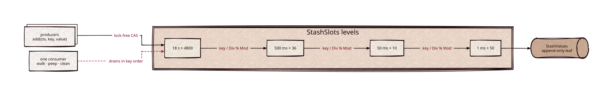

# stash

Part of [Kronuz C++ Libraries](https://github.com/Kronuz/cpp-libraries), a collection of small, reusable C++ libraries.

[](https://github.com/Kronuz/stash/actions/workflows/ci.yml)
[](LICENSE)


A lock-free, hierarchical slot store for C++17: many threads insert values by
integer key without locks, and one consumer drains them in key order. It is the
storage under a multi-resolution timer wheel, for anyone building a scheduler,
debouncer, or timer queue.



## ✨ Highlights

- **Producers never block each other.** Every insert is an atomic fetch-add or a
  compare-and-swap; there is no lock to queue behind.
- **Flat tail latency under contention.** With 14 threads inserting, p99 stays at
  1.4–1.8 µs, where a locked heap and Asio's timers reach 65 µs to over 1 ms
  ([bench/RESULTS.md](bench/RESULTS.md), Apple M4 Pro).
- **Memory follows what is live.** Levels and chunks are allocated on first use,
  so a 24-hour wheel at 1 ms resolution costs only the slots that hold something.
- **Answers "what is due now?"**, which a lock-free queue cannot.
- **Header-only, no dependencies.** Tracing hooks are no-ops unless you inject
  your own.

## 📦 Installation

Requires a C++17 compiler and, for the CMake route, CMake 3.14 or newer. CI
builds it with GCC and Clang on Linux (x86_64, arm64), macOS (arm64, x86_64), and
FreeBSD.

With CMake `FetchContent`:

```cmake
include(FetchContent)
FetchContent_Declare(stash
  GIT_REPOSITORY https://github.com/Kronuz/stash.git
  GIT_TAG        main)
FetchContent_MakeAvailable(stash)

target_link_libraries(my_app PRIVATE stash::stash)
```

Or copy `stash.h` and `stash_trace.h` onto your include path.

## 🚀 Quick start

A one-level wheel over a leaf: insert at keys 1–3, then walk everything due
before key 6. This is the smoke test in [`test/test.cc`](test/test.cc).

```cpp
#include "stash.h"

#include <cstdio>
#include <memory>

using Item  = std::shared_ptr<int>;                  // values must be pointer-like
using Leaf  = StashValues<Item, 4>;
using Wheel = StashSlots<Leaf, 8, /*Div*/ 1, /*Mod*/ 8>;

int main() {
	Wheel wheel;
	StashContext ctx(0);
	wheel.add(ctx, 1, std::make_shared<int>(11));
	wheel.add(ctx, 2, std::make_shared<int>(22));
	wheel.add(ctx, 3, std::make_shared<int>(33));

	Item item;
	for (;;) {
		ctx.begin_key = ctx.atom_first_valid_key.load();
		ctx.end_key = 6;
		item.reset();
		if (!wheel.next(ctx, &item)) { break; }
		if (item) { std::printf("%d ", *item); }   // prints 11 22 33
	}
}
```

[`examples/demo.cc`](examples/demo.cc) tours the rest: nested levels, `peep`,
the horizon guard, and a producer/consumer run.

## 🎯 When to use stash, and when not

Its best shape: many threads add deadline-tagged items, one thread fires what is due, and most items fire rather than get cancelled. Deferred logging and per-key debouncing are that shape (they reach stash through [scheduler](https://github.com/Kronuz/scheduler)).

- ✅ Timers or deferred work armed from many threads, at millisecond resolution, within the wheel's horizon.
- ✅ Bucketing values by a clock tick and draining them in key order: scheduler queues, timer wheels, debounce tables.
- ❌ A general map or queue, more than one consumer, or values that are not pointer-like (a null or "zero" value reads as absent).
- ❌ Timers owned by one event loop (connection idle timeouts, request deadlines, protocol ticks): there is no producer contention to remove, and the loop's own timers (Asio `steady_timer`, `reactor::PeriodicTimer`) cancel exactly.
- ❌ Timers that are usually cancelled or slid forward (an idle timeout reset per request, an election timer reset per heartbeat): see "Cancel" below.
- ❌ A handful of timers, exact deadline order, or sub-millisecond deadlines.

### Limits

| | |
| --- | --- |
| Resolution | The finest slot (`_Div` of the lowest level): 1 ms on Xapiand's stack. A slot drains whole once the walk reaches it, so an item can fire up to one finest slot early, and items in one slot fire in arrival order, not deadline order. |
| Horizon | The outermost `_Div * _Mod`, counted from the slot of `first_valid`: 24 h on Xapiand's stack (`4800 x 18 s`), so keys below `first_valid` + 24 h - 18 s are always accepted (`first_valid` trails now by about a walk interval). Past the horizon `add` returns `stash_result::past_horizon` and stores nothing; scheduler's `add` returns `schedule_result::past_horizon`. A producer stalled mid-`add` holds `first_valid` and so the horizon. |
| Walker | One thread runs `walk`, `peep`, and `clean`. Any number of threads `add`. More than 64 inserts in flight at once pin `first_valid` (and so `clean` and the horizon) until they finish. |
| Order | Ascending by finest slot. A key already overdue is filed at the last walk's end, so overdue items sort together. |
| Cancel | None: stash has no remove and no reschedule. A caller cancels by flagging the value dead (scheduler's `clear()` is one CAS). The entry stays, and so does the object its value points to, until the walk drains its slot, which can be the whole remaining delay. Moving a deadline later is cancel plus a new add, and each leaves a dead entry behind. Dead entries pending are about the cancel rate times the delay. |
| Memory | About 4.3 KB per `StashContext` (64 cache-line announce slots; scheduler holds two), a 38 KB top-level chunk on first insert on Xapiand's stack, about 160 B per distinct finest slot in use, and per pending item an 8 B slot plus one heap-allocated pointer-like value (16 B for a `shared_ptr`) plus the item itself. Sizes are from the layout, not measured. Share one wheel across everything that can share a walker; a wheel per object multiplies the fixed costs. |

### Which timers fit

1. Per-index refresh and flush deadlines in strata at tens of thousands of open indexes: fits with changes. Arm when an index first gets dirty and re-arm when the timer fires, so an idle index holds no timer. Use one shared wheel per host, a clock injected from the executor (scheduler reads `steady_clock` directly), and `weak_ptr` values so a closed index is not kept alive by its pending entry.
2. Time-windowed retention drops (a timer per window or segment, days to months out): fits with one more level (below), plus re-arming from the persisted window bounds at open. A handful of timers; reuse the host's timer service rather than add one.
3. Debouncers (Xapiand's committer, replication, and updater debouncers): in use today, and the cancel pattern above. They fit better with a lazy re-arm in the debouncer (a touch stores the latest arguments and deadline; the one pending task re-adds itself when it fires early), which is a scheduler change.

### What to use instead

1. Owner-loop timers: Asio `steady_timer` or `reactor::PeriodicTimer`. For many per-connection timeouts keep one timer per connection and re-arm lazily.
2. TTL for cache entries or idle eviction: `lru::aging_lru` with `trim()`, which needs no timers.
3. A few hundred timers on one thread, with exact order: a binary heap owned by that thread.
4. Per-document TTL: a filter at query time plus dropping whole windows, never a timer per document.

### Extending the horizon (not built)

Each level's span equals the next level's slot width, so one more level above `4800 x 18 s` reaches about a year:

```cpp
// Div = 24 h, Mod = 367: keys below first_valid + 366 days are accepted; Size = Mod keeps it one chunk (2.9 KB).
using _367_1d = StashSlots<_4800_18s, 367ULL, 86400ULL * 1000 * MS, 367ULL>;
```

It costs no context memory and does not change the announce handshake or `refresh_first_valid_cap`, which are independent of depth. An insert descends one more level and a walk call recurses one more; an empty-range walk is bounded by the window, not the horizon. Each distinct day in use gets its own 38 KB `4800 x 18 s` chunk (two on a wheel with timers on both sides of midnight); a smaller `Size` on that level trades memory for up to `slot / Size` hops on an insert. A caller can instead hop: arm for the next 23 hours and re-arm when it fires.

## 📚 Documentation

- [docs/API.md](docs/API.md): every type and member, and the tracing hooks.
- [ARCHITECTURE.md](ARCHITECTURE.md): the three templates, traversal, the
  concurrency model and reclamation, and the cost model.
- [AGENTS.md](AGENTS.md): repository map, invariants, and traps, for anyone
  changing the code.
- [bench/](bench/README.md): the benchmarks and [their results](bench/RESULTS.md).
- [examples/colored_trace/](examples/colored_trace/README.md): plugging in
  colored tracing without editing `stash.h`.
- [Xapiand's SCHEDULER.md](https://github.com/Kronuz/Xapiand/blob/master/SCHEDULER.md):
  the scheduler built on it.

## 🛠️ Building and testing

```sh
cmake -B build && cmake --build build && ctest --test-dir build
./build/stash_demo
```

## 🤝 Contributing

Issues and pull requests are welcome. Read [AGENTS.md](AGENTS.md) first: it lists
the invariants a change must keep. CI must pass on every platform.

## 📄 License

MIT, Copyright (c) 2015-2019 Dubalu LLC. See [LICENSE](LICENSE). Extracted from
[Xapiand](https://github.com/Kronuz/Xapiand).
