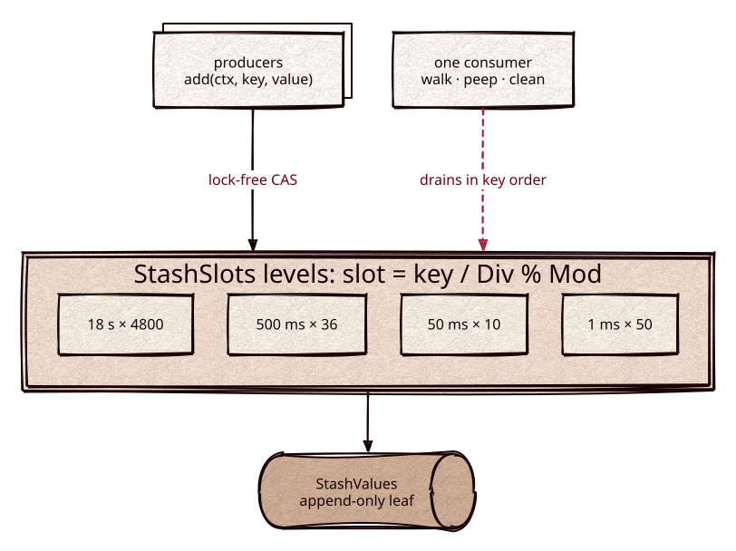

# stash

Part of [Kronuz C++ Libraries](https://github.com/Kronuz/cpp-libraries), a collection of small, reusable C++ libraries.

[](https://github.com/Kronuz/stash/actions/workflows/ci.yml)
[](LICENSE)


Lock-free hierarchical slot store for C++17: many threads insert by integer key, one
consumer drains in key order. Each level maps a key to a slot with `key / Div % Mod`
and nests the next, finer level, so the whole is a multi-resolution timer wheel whose
producers never take a lock. Reach for it when you build a scheduler, debouncer, or
timer queue that many threads arm and one thread fires.



## ✨ Highlights

- **Producers never block each other.** Every insert is an atomic fetch-add or a
  compare-and-swap; there is no lock to queue behind.
- **Flat tail under contention.** With 14 threads arming, the p99 insert stays at
  about 1 to 2 µs at every depth measured (see [Performance](#-performance)).
- **Memory follows what is live.** Levels and chunks are allocated on first use, so a
  24-hour wheel at 1 ms resolution costs only the slots that hold something.
- **Answers "what is due now?"** A walk drains every value below a key in key order,
  and a peep reads them without draining. A lock-free queue has no notion of when.
- **Refuses what it cannot hold.** `add` returns `stash_result::past_horizon` for a
  key beyond the outermost level's span and stores nothing.
- **Header-only, no dependencies.** Tracing hooks are no-ops unless you inject your
  own header.

## 🚀 Quick start

A one-level wheel over a leaf: insert at keys 1 to 3, then walk everything due
before key 6. This is the smoke test in [`test/test.cc`](test/test.cc).

```cpp
#include "stash.h"

#include <cstdio>
#include <memory>

using Item  = std::shared_ptr<int>;                  // values must be pointer-like
using Leaf  = StashValues<Item, 4>;
using Wheel = StashSlots<Leaf, 8, /*Div*/ 1, /*Mod*/ 8>;

int main() {
	Wheel wheel;
	StashContext ctx(0);
	wheel.add(ctx, 1, std::make_shared<int>(11));
	wheel.add(ctx, 2, std::make_shared<int>(22));
	wheel.add(ctx, 3, std::make_shared<int>(33));

	Item item;
	for (;;) {
		ctx.begin_key = ctx.atom_first_valid_key.load();
		ctx.end_key = 6;
		item.reset();
		if (!wheel.next(ctx, &item)) { break; }
		if (item) { std::printf("%d ", *item); }   // prints 11 22 33
	}
}
```

[`examples/demo.cc`](examples/demo.cc) tours the rest: nested levels, `peep`, the
horizon guard, and a producer/consumer run.

## 📦 Installation

Requires a C++17 compiler and CMake 3.14 or newer; no other dependencies. CI builds
and tests it with GCC and Clang on Linux (x86_64, arm64), macOS (arm64, x86_64), and
FreeBSD, plus ASan, UBSan, and TSan builds.

```cmake
include(FetchContent)
FetchContent_Declare(stash
  GIT_REPOSITORY https://github.com/Kronuz/stash.git
  GIT_TAG        486b37fa8308bd1609fcb8cf8c021dad67b490fd)  # or main, which tracks the tip
FetchContent_MakeAvailable(stash)

target_link_libraries(my_app PRIVATE stash::stash)
```

Then `#include "stash.h"`. Without CMake, copy `stash.h` and `stash_trace.h` onto
your include path.

## 🎯 When to use it

Its best shape: many threads add deadline-tagged items, one thread fires what is due,
and most items fire rather than get cancelled. Timers or deferred work armed from many
threads at millisecond resolution fit, and so does bucketing values by a clock tick to
drain them in key order (scheduler queues, timer wheels, debounce tables). Deferred
logging and per-key debouncing are that shape; they reach stash through
[scheduler](https://github.com/Kronuz/scheduler).

Not for:

- **A general map or queue, or more than one consumer.** One thread walks, peeps, and
  cleans; values must be pointer-like, and a null or "zero" value reads as absent.
- **Timers owned by one event loop** (connection idle timeouts, request deadlines,
  protocol ticks). There is no producer contention to remove, and the loop's own
  timers (Asio `steady_timer`, `reactor::PeriodicTimer`) cancel exactly.
- **Timers that are usually cancelled or moved.** stash has no remove: a caller flags
  the value dead, and the entry stays until the walk drains its slot.
- **A handful of timers, exact deadline order, or sub-millisecond deadlines.** A slot
  drains whole, so items in one finest slot fire in arrival order.
- **Keys past the horizon.** The outermost `Div * Mod` bounds how far ahead a key may
  be: 24 hours on Xapiand's four-level wheel.

[ARCHITECTURE.md](ARCHITECTURE.md#limits-and-fit) has the full limits (resolution,
horizon, memory), which timers fit, and what to use instead.

## ⚡ Performance

Insert (arm) latency at a bounded pending depth, 14 threads arming and one draining,
p99 in µs, the median of four runs of `bench_steady` ([bench/RESULTS.md](bench/RESULTS.md)):

| Machine | Pending depth | stash | `std::mutex` + binary heap | Asio 1.30.2 `steady_timer` |
| --- | ---: | ---: | ---: | ---: |
| Apple M4 Pro | 64 | **2.1** | 914 | 591 |
| Apple M4 Pro | 1,024 | **1.4** | 120 | 144 |
| Apple M4 Pro | 16,384 | **1.2** | 63 | 161 |
| Intel Core i9-9980HK | 64 | **1.2** | 198 | 118 |
| Intel Core i9-9980HK | 1,024 | **1.1** | 119 | 131 |
| Intel Core i9-9980HK | 16,384 | **1.1** | 108 | 70 |

Apple clang 17 on macOS, `-O3 -DNDEBUG`; the M4 Pro has 10 performance and 4 efficiency
cores, the i9 has 8 cores and 16 threads. The p99 of the heap and of Asio moves by a factor
of two between runs, because a lock makes producers queue behind a descheduled holder.

```sh
cmake -S bench -B build-bench -DCMAKE_BUILD_TYPE=Release
cmake --build build-bench
./build-bench/bench_steady
```

[bench/README.md](bench/README.md) describes the other benchmarks (spread and
convergent keys, many mostly idle producers) and [docs/perf/](docs/perf/) the
measured variants.

## 📚 Documentation

- [docs/API.md](docs/API.md): every type and member, and the tracing hooks.
- [ARCHITECTURE.md](ARCHITECTURE.md): the three templates, traversal, the concurrency
  model and reclamation, limits and fit, and the cost model.
- [bench/](bench/README.md): the benchmarks and [their results](bench/RESULTS.md).
- [examples/colored_trace/](examples/colored_trace/README.md): colored tracing without
  editing `stash.h`.
- [CHANGELOG.md](CHANGELOG.md): notable changes.
- [AGENTS.md](AGENTS.md): repository map, invariants, and traps, for anyone changing
  the code.
- [Xapiand's SCHEDULER.md](https://github.com/Kronuz/Xapiand/blob/master/SCHEDULER.md):
  the scheduler built on it.
- [Catalog entry](https://github.com/Kronuz/cpp-libraries/blob/main/AGENTS.md#stash).

## 🛠️ Building and testing

```sh
cmake -B build
cmake --build build
ctest --test-dir build
./build/stash_demo
```

The benchmarks build on their own from `bench/` (see [Performance](#-performance)).

## 🤝 Contributing

Issues and pull requests are welcome. Read [AGENTS.md](AGENTS.md) first: it lists the
invariants a change must keep, and the
[catalog's AGENTS.md](https://github.com/Kronuz/cpp-libraries/blob/main/AGENTS.md) has the
family's rules. CI must pass on every platform.

## 📄 License

MIT; see [LICENSE](LICENSE). Extracted from [Xapiand](https://github.com/Kronuz/Xapiand).
